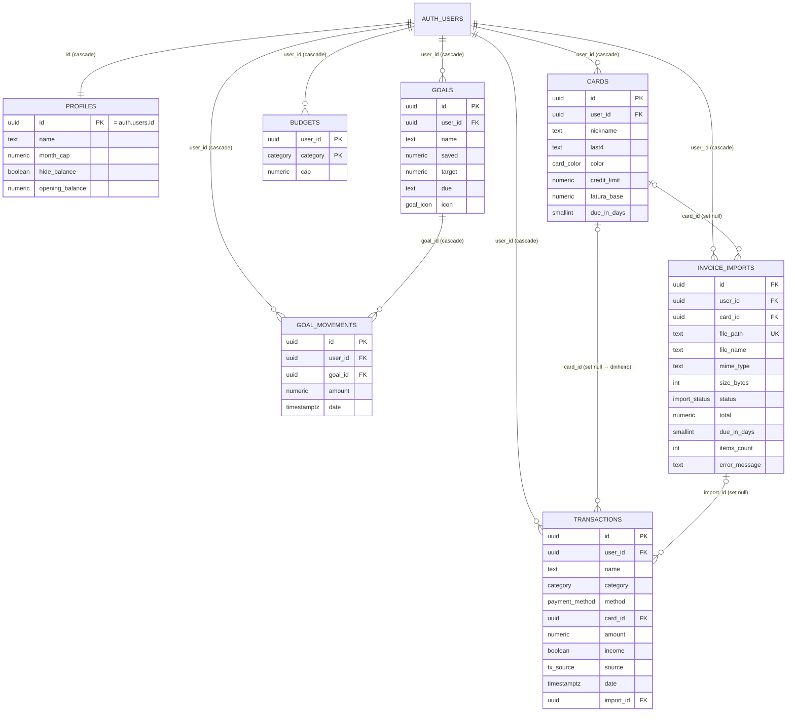

# Banco de dados — Cofrinho (Supabase)

Projeto Supabase `eyhybcegxlanckgkglau` (Postgres 17). A fonte da verdade são as migrations em `supabase/migrations/`; `prisma/schema.prisma` é só documentação; `src/lib/database.types.ts` são os tipos gerados para o `supabase-js`.

| Migration | O que faz |
|---|---|
| `20261122170648_schema.sql` | enums, 7 tabelas, checks, índices, triggers (`updated_at`, perfil no cadastro, cartão apagado → dinheiro) |
| `20261122170733_rls.sql` | grants mínimos, RLS e 27 policies (uma por operação) |
| `20261122170846_funcoes.sql` | RPCs `save_goal_movement`, `delete_goal_movement`, `delete_goal`, `import_invoice` |
| `20261122170905_storage.sql` | bucket privado `faturas` + 4 policies em `storage.objects` |
| `20261122170955_seed_demo.sql` | conta demo `lucas@cofrinho.app` com os dados de `src/lib/data.ts` |

Cada arquivo termina com um comentário de rollback.

## Diagrama

Todas as tabelas têm `created_at` e `updated_at` (`timestamptz`, `updated_at` mantido por trigger). Valores em reais são `numeric(12,2)`.

**FKs compostas.** `cards`, `goals` e `invoice_imports` têm `unique (id, user_id)`. As FKs filhas apontam para `(id, user_id)`, o que impede no próprio banco que um lançamento use o cartão de outra pessoa, ou que um movimento caia na meta de outra pessoa. Nos SET NULL, só a coluna da FK é zerada (`on delete set null (card_id)`, recurso do Postgres 15+).

## Enums

Escolhi enum do Postgres em vez de `check (... in (...))` porque são domínios fechados, que já existem como union types no front. Com enum, o tipo aparece em `database.types.ts` e no Prisma, e o PostgREST recusa valor errado com mensagem clara. A contrapartida é que tirar um valor de um enum dá trabalho: adicionar é `alter type ... add value`, remover exige recriar o tipo. Para regras numéricas e de formato usei `check`.

| Enum | Valores | Front |
|---|---|---|
| `category` | moradia, alimentacao, transporte, lazer, assinaturas, outros | `CategoryId` |
| `payment_method` | pix, dinheiro, card | `Tx.method` (com `card`, o id do cartão vai em `card_id`) |
| `card_color` | ciano, lima, menta | `Card.color` |
| `tx_source` | manual, fatura | `Tx.source` |
| `goal_icon` | plane, shield, book, car, target | `Goal.icon` |
| `import_status` | enviada, lida, importada, erro | — (novo) |

## Tabelas e colunas

### `profiles` (1 por usuário)
| Coluna | Tipo | Regra | Front |
|---|---|---|---|
| id | uuid PK → auth.users | cascade | — |
| name | text | ≤ 40, default '' | `User.name` |
| month_cap | numeric(12,2) | ≥ 0; 0 = sem teto | `State.monthCap` |
| hide_balance | boolean | default false | `State.hidden` |
| opening_balance | numeric(12,2) | pode ser negativo | `State.opening` |

Criado pelo trigger `on_auth_user_created` (`handle_new_user`, security definer, `search_path = ''`), que usa `raw_user_meta_data.name`. O e-mail fica em `auth.users`.

### `cards`
| Coluna | Tipo | Regra | Front |
|---|---|---|---|
| nickname | text | 1–20; único por usuário sem diferenciar maiúsculas nem espaços nas pontas (`lower(btrim())`) | `nickname` |
| last4 | text | `^[0-9]{4}$` | `last4` |
| color | card_color | default ciano | `color` |
| credit_limit | numeric(12,2) | ≥ 0 | `limit` (renomeado porque `limit` é palavra reservada no SQL e parâmetro do PostgREST) |
| fatura_base | numeric(12,2) | ≥ 0 | `faturaBase` |
| due_in_days | smallint | 1–60, default 10 | `dueInDays` |

### `transactions`
| Coluna | Tipo | Regra | Front |
|---|---|---|---|
| name | text | 1–40 | `name` |
| category | category | — | `category` |
| method | payment_method | `method = 'card'` ⇔ `card_id is not null` | `method` (`'card'` + `card_id` = id do cartão) |
| card_id | uuid | FK (card_id, user_id) → cards, set null | — |
| amount | numeric(12,2) | > 0 | `amount` |
| income | boolean | default false | `income` |
| source | tx_source | default manual | `source` |
| date | timestamptz | default now() | `date` |
| import_id | uuid | FK (import_id, user_id) → invoice_imports, set null | — |

Trigger `transactions_card_removed`: quando o cartão é apagado, o FK zera `card_id` e o trigger troca `method` para `'dinheiro'`. As compras continuam, como no reducer `card/delete`. Índices: `(user_id, date desc)`, `(card_id, user_id)` e `(import_id, user_id)` (os dois últimos parciais).

### `budgets` (teto por categoria)
PK `(user_id, category)`, `cap` numeric(12,2) ≥ 0 (0 = sem teto). Upsert por `(user_id, category)`.

### `goals`
`name` 1–30, `saved` ≥ 0 (default 0), `target` > 0, `due` texto ≤ 20 (ex.: "Dez 2027"), `icon` goal_icon (default target). Índice `(user_id, created_at)`.

### `goal_movements`
`goal_id` + `user_id`: FK composta → goals, cascade. `amount` ≠ 0 (> 0 guardou, < 0 retirou). `date` default now(). Índices `(goal_id, user_id, date desc)` e `(user_id, date desc)`.

### `invoice_imports` (fatura enviada)
| Coluna | Tipo | Regra |
|---|---|---|
| card_id | uuid | FK (card_id, user_id) → cards, set null |
| file_path | text unique | precisa começar com `{user_id}/` (caminho no bucket `faturas`) |
| file_name | text | 1–255 |
| mime_type | text | `application/pdf` ou `image/*` |
| size_bytes | integer | 1 byte a 15 MB (15728640) |
| status | import_status | enviada → lida → importada (ou erro) |
| total | numeric(12,2) | ≥ 0, nulo até ler |
| due_in_days | smallint | 1–60, nulo |
| items_count | integer | ≥ 0 |
| error_message | text | ≤ 500 |

Apagar a importação não apaga os lançamentos: `import_id` vira nulo. O arquivo no Storage precisa ser apagado pela API do Storage, porque SQL não apaga arquivos.

## Permissões e RLS

- `anon`: nenhum grant nas 7 tabelas e nenhum `execute` nas RPCs. Os default privileges de `public` também foram ajustados para tabelas e funções futuras não abrirem para `anon`.
- `authenticated`: `select, insert, update, delete` em tudo, menos `delete` em `profiles` (o perfil some quando a conta é apagada).
- `service_role` continua com o padrão do Supabase e ignora o RLS. Use só no servidor.
- RLS ligado nas 7 tabelas. Uma policy por operação, todas `to authenticated`, sempre com `(select auth.uid())`, que vira initPlan e é avaliado uma vez por query.

| Tabela | select | insert | update | delete |
|---|---|---|---|---|
| profiles | `id = uid` | `id = uid` | `id = uid` (using + check) | — (sem grant) |
| cards | `user_id = uid` | `user_id = uid` | `user_id = uid` (using + check) | `user_id = uid` |
| transactions | idem | idem | idem | idem |
| budgets | idem | idem | idem | idem |
| goals | idem | idem | idem | idem |
| goal_movements | idem | idem | idem | idem |
| invoice_imports | idem | idem | idem | idem |

Nomes das policies: `<tabela>_select`, `<tabela>_insert`, `<tabela>_update`, `<tabela>_delete`.

## Funções RPC

Todas são `security invoker` (rodam com o RLS de quem chama), com `set search_path = ''`, `execute` só para `authenticated` e revogadas de `public` e `anon`. Cada chamada roda numa transação. Erros de regra saem com SQLSTATE `P0001` (`P0002` = não encontrado) e mensagem em português, pronta para o toast.

| Função | Retorna | Regra |
|---|---|---|
| `save_goal_movement(p_goal_id, p_amount, p_date?, p_id?)` | `goal_movements` | Sem `p_id`, cria. Com `p_id`, edita e aplica só a diferença (trocar de meta também funciona). `goals.saved += delta`, `profiles.opening_balance -= delta`. Falha se a meta ficar negativa ("Valor maior que o guardado na meta.") ou se o valor for 0. |
| `delete_goal_movement(p_id)` | `goal_movements` apagado, ou `null` | Desfaz o movimento na meta e no saldo. Falha se a meta ficaria negativa (depósito já retirado). |
| `delete_goal(p_id)` | valor devolvido, ou `null` | Apaga a meta (os movimentos vão junto em cascata) e devolve `saved` ao saldo. |
| `import_invoice(p_import_id, p_items, p_card_id?, p_date?)` | quantidade criada | Insere os lançamentos (`source = 'fatura'`, `method = 'card'` ou `'dinheiro'`), marca a importação como `importada` e soma `items_count`. Um item inválido desfaz tudo. |

Funções internas sem `execute` para ninguém: `touch_updated_at`, `handle_new_user`, `tx_card_removed`.

**Diferença em relação ao reducer local:** no front, `move/delete` e `move/save` usam `Math.max(0, …)` na meta. No banco, a operação é recusada em vez de cortar o valor, para o dinheiro nunca sumir nem aparecer do nada.

**Apagar a conta:** Edge Function `delete-account` (publicada; código em `supabase/functions/delete-account/index.ts`, `verify_jwt` ligado, recusa a conta demo) que valida o JWT de quem chama e roda `auth.admin.deleteUser(user.id)` com a service role. Tudo em `public` tem `on delete cascade` a partir de `auth.users`. Os arquivos da pasta `{uid}/` no bucket `faturas` precisam ser apagados antes, pela API do Storage (`list` + `remove`).

## Storage

- Bucket `faturas`: privado, limite de 15 MB, MIME aceitos `application/pdf`, `image/jpeg`, `image/png`, `image/webp`, `image/heic` e `image/heif`.
- Caminho: `{auth.uid()}/{arquivo}`, por exemplo `uid/2026-11/fatura.pdf`. Grave o mesmo caminho em `invoice_imports.file_path`.
- Policies em `storage.objects` (`faturas_select`, `faturas_insert`, `faturas_update`, `faturas_delete`): `bucket_id = 'faturas' and (storage.foldername(name))[1] = (select auth.uid())::text`.
- Leitura pelo front com `createSignedUrl`, já que não há URL pública.

Fluxo sugerido da fatura:
1. `storage.from('faturas').upload(uid/arquivo)`.
2. `insert invoice_imports` com `status 'enviada'`.
3. `/api/fatura` lê o arquivo e o front faz `update` com `status 'lida'` e `total`.
4. Confirmar chama `rpc('import_invoice', { p_import_id, p_items, p_card_id })`.

## Dados de demonstração

A migration `20261122170955_seed_demo.sql` é idempotente: não faz nada se a conta já existir.

| Tabela | Linhas |
|---|---|
| auth.users / auth.identities | 1 / 1 (`lucas@cofrinho.app`, e-mail confirmado, senha de demonstração de `src/lib/data.ts`, provider `email`) |
| profiles | 1 (Lucas, `month_cap` 3200, `opening_balance` 10640, de modo que o saldo fica em R$ 14.500) |
| cards | 3 (Viagem 1180 lima; Salário 6917 menta; Principal 4552 ciano). Faturas: 98, 640 e 1284 |
| transactions | 14 (1 entrada e 13 gastos, todos no mês em que a migration rodou) |
| budgets | 4 (alimentação 774, moradia 900, transporte 800, lazer 385) |
| goals | 4 (Japão 13600/20000, Reserva 7200/10000, Curso 2700/3000, Carro 9600/40000) |
| goal_movements | 5 (histórico; já contado em `saved`, por isso entra sem passar pela RPC) |

As datas são fixas: refletem o mês de 22/11/2026, quando a migration foi aplicada. No mês seguinte, a Home da demo mostra o mês atual vazio.

O id da demo é `c0f1d000-0000-4000-8000-00000000d3e0`. Para remover só a demo, rode `supabase/seed/remover_dados_demo.sql` no SQL Editor. Ele apaga o usuário e tudo dele em cascata, sem tocar em outros usuários.

## Ação do front → operação

| Ação (`dispatch`) | Operação no Supabase |
|---|---|
| `tx/save` | `from('transactions').upsert(...)`, com `method: 'card'` + `card_id` quando for cartão |
| `tx/delete` | `from('transactions').delete().eq('id', id)` |
| `tx/import` | upload em `faturas` → `insert invoice_imports` → `rpc('import_invoice')` |
| `card/save` | `from('cards').upsert(...)` (`limit` → `credit_limit`) |
| `card/delete` | `from('cards').delete()`; os lançamentos viram `'dinheiro'` no próprio banco |
| `budget/set` | `from('budgets').upsert({ user_id, category, cap }, { onConflict: 'user_id,category' })`; remover teto = `cap 0` ou `delete` |
| `monthCap/set` | `from('profiles').update({ month_cap })` |
| `goal/save` | `from('goals').upsert(...)` (sem mexer em `saved` na edição) |
| `goal/delete` | `rpc('delete_goal', { p_id })` |
| `move/save` | `rpc('save_goal_movement', { p_goal_id, p_amount, p_date, p_id })` |
| `move/delete` | `rpc('delete_goal_movement', { p_id })` |
| `user/rename` | `from('profiles').update({ name })` (e `auth.updateUser({ data: { name } })`, se quiser manter o metadata) |
| `hidden/toggle` | `from('profiles').update({ hide_balance })` |
| `deleteAccount()` | `functions.invoke("delete-account")` (Edge Function com a service role) |
| `reset` | só faz sentido na demo; no banco, rodar o script de remoção e reaplicar o seed |

Leitura inicial (`loadData`): `profiles` (1 linha), `cards`, `transactions` (por `date`), `budgets`, `goals`, `goal_movements`. Tudo filtrado pelo RLS, sem precisar de `.eq('user_id', ...)`.

## Validação (22/11/2026)

Testado com `execute_sql`, simulando `authenticated` (dois usuários de teste) e `anon` com `set local role` + `request.jwt.claims`. Os dados de teste foram apagados no fim: 74 verificações, todas passaram depois da correção de um erro de nome de variável no próprio script de teste. Advisors: performance sem avisos. Security só aponta "Leaked Password Protection Disabled", uma configuração do Auth no Dashboard.
